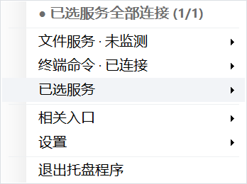
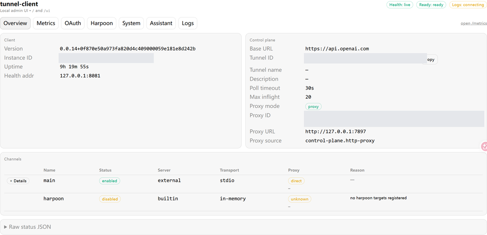
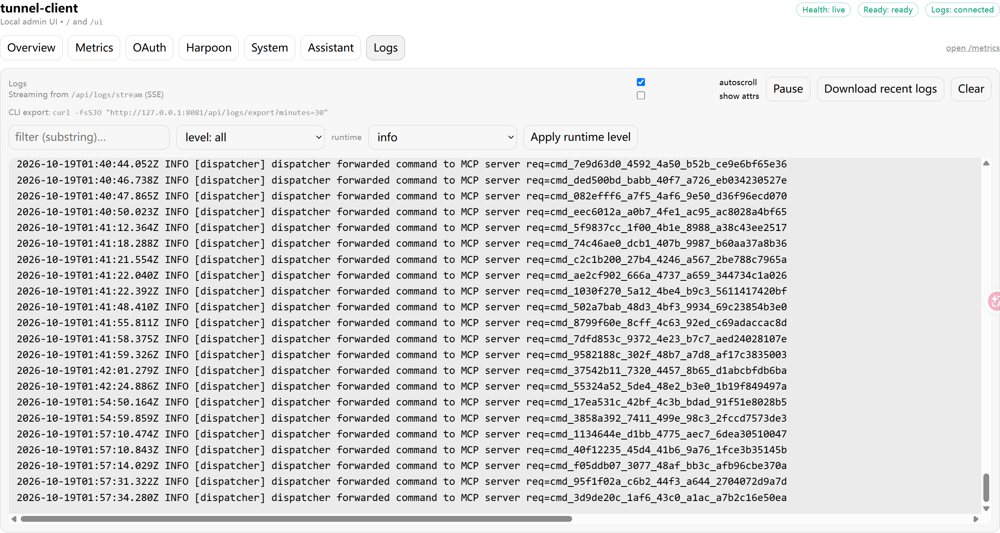

# AI Context Sync — Windows tray manager

[简体中文](README.zh-CN.md) · [Commander customization](https://github.com/SANG4242/DesktopCommanderMCP/tree/custom/chatgpt-ui) · [Project background](https://sang4242.pages.dev/en/projects/desktop-commander/)

A Windows tray application that manages the local services behind my ChatGPT setup. It starts and stops two independent OpenAI Tunnel Client processes, reports their health, and provides per-service logs and a command-line control client.

I built it while using ChatGPT with files and projects already stored on my computer. The files stay in their original locations; the manager controls access services rather than maintaining another copy of them.

## Components

```text
ChatGPT
  → OpenAI Secure MCP Tunnel
  → local tunnel-client
       ├─ Desktop Commander customization · port 8081
       └─ Filesystem MCP · port 8080, optional fallback
            ↑
     Windows tray + AIContextSyncCtl
```

| Component | Source |
| --- | --- |
| Tray, service controls and CLI in this repository | My C#/.NET implementation, developed with AI assistance and local debugging. |
| Terminal/Diff Apps and file-operation extensions | My changes to [Desktop Commander](https://github.com/SANG4242/DesktopCommanderMCP/tree/custom/chatgpt-ui); the base server and existing File Preview come from upstream. |
| Secure MCP Tunnel and tunnel-client | Official OpenAI infrastructure/client. Obtain the client through your OpenAI Tunnel setup. |
| Filesystem MCP | Official `@modelcontextprotocol/server-filesystem` package. |

## Daily controls

- Start, stop or restart one service without restarting the other.
- Choose which services participate in monitoring and batch operations.
- See local health/readiness, MCP process state and control-plane reachability.
- Open the corresponding official Tunnel management UI or select its log stream.
- Configure login startup, connection on tray startup and notifications.
- Use `AIContextSyncCtl` from scripts to query or control the running tray.

### Tray menu



This screenshot shows Commander selected and Filesystem excluded from monitoring.

### Official Tunnel UI opened from the manager





These two browser pages belong to the official Tunnel Client. The tray provides their entry points; it does not implement those pages. Instance and tunnel identifiers have been covered.

## Requirements

- Windows 10/11 x64; development and daily use were on Windows 11.
- .NET 9 SDK to build. The framework-dependent executable requires .NET 9 Desktop Runtime.
- Node.js 22, the Commander source build, and official Tunnel Client `0.0.14` with its accompanying files.
- An OpenAI account/workspace with access to the required Tunnel and ChatGPT MCP/App features.

The repository contains the manager source and profile examples. It does not include credentials, official executables, Node dependencies, or the full Commander tree. Dependency versions are listed in `tools.dependencies.json`.

## Setup

### 1. Build the manager

```powershell
git clone https://github.com/SANG4242/ai-context-sync.git
cd ai-context-sync
dotnet publish tray/AIContextSyncTray.csproj -c Release -r win-x64 --self-contained false -o artifacts/win-x64
```

The publish target also builds `AIContextSyncCtl.exe` into the same output directory. If using a release ZIP, extract it inside this repository as `artifacts/win-x64/`.

### 2. Prepare local dependencies

```powershell
git clone --branch custom/chatgpt-ui https://github.com/SANG4242/DesktopCommanderMCP.git tools/desktop-commander
npm --prefix tools/desktop-commander ci --ignore-scripts
npm --prefix tools/desktop-commander run build
npm install --prefix tools/filesystem-mcp --save-exact --ignore-scripts @modelcontextprotocol/server-filesystem@2026.8.31
```

Keep the official Tunnel Client distribution together at `tools/tunnel-client/v0.0.14/bin/`, including `tunnel-client.exe`, its companion executable and notices. Alternatively set `AI_CONTEXT_SYNC_TUNNEL_CLIENT` to its absolute executable path.

### 3. Configure profiles

Copy both examples to their local names. Actual `.yaml` profiles are ignored by Git.

```powershell
Copy-Item config/tunnel-client/local-desktop-commander.example.yaml config/tunnel-client/local-desktop-commander.yaml
Copy-Item config/tunnel-client/local-filesystem.example.yaml config/tunnel-client/local-filesystem.yaml
```

For each service, create a Tunnel in your OpenAI workspace and enter its ID. Use separate Tunnels when enabling both services. Keep `api_key` as an `env:VARIABLE_NAME` or `file:C:/absolute/path/to/key.txt` reference. The secret value belongs outside the repository and authorized file directories.

Set the referenced environment variable before launching the tray, or use a local key file. The tray resolves the reference for its control-plane check; the Tunnel Client receives only the reference in its arguments.

The examples enclose command values in single YAML quotes. Edit the Filesystem example's `C:/mcp-workspace` to an existing directory you intend to authorize. Quote paths containing spaces inside the command. The manager supports these simple profile fields, not arbitrary YAML editing.

If an outbound proxy is needed, add `http_proxy: http://127.0.0.1:PORT` under `control_plane`. Without this field, the manager does not require a local proxy. Health/admin endpoints must remain on `127.0.0.1` with the documented ports.

### 4. Start and connect

```powershell
$env:AI_CONTEXT_SYNC_ROOT = (Get-Location).Path
& ./artifacts/win-x64/AIContextSyncTray.exe
```

Use **Settings → monitored MCPs** to select the services, then start the selected service. Connecting automatically is opt-in in the public build. Configure the matching connection in ChatGPT using your workspace's Tunnel setup.

The UI is currently Chinese. `AI_CONTEXT_SYNC_ROOT` overrides the project directory; `AI_CONTEXT_SYNC_DATA_DIR` overrides the runtime-data directory. The default runtime location is `%LOCALAPPDATA%/AIContextSync`, outside the source repository. The manager uses the fixed service health ports 8080/8081.

## CLI

The tray must already be running under the same Windows user.

```powershell
./artifacts/win-x64/AIContextSyncCtl.exe service status all --json
./artifacts/win-x64/AIContextSyncCtl.exe service restart commander --json
./artifacts/win-x64/AIContextSyncCtl.exe service stop filesystem
```

The CLI supports `status`, `start`, `stop`, `restart`, with `commander`, `filesystem` or `all` as the target.

## Checks and operational notes

```powershell
dotnet build tray/AIContextSyncTray.csproj -c Release
dotnet run --project tests/ManagerChecks/ManagerChecks.csproj -c Release
```

The offline checks inspect path overrides, profile parsing and launch arguments without starting a Tunnel, connecting to OpenAI, or changing Windows startup settings. Existing screenshots document the daily-use version. The public configuration changes require a live end-to-end check in the user's own workspace.

- Control-plane reachability is a separate signal from local readiness. A failed check may reflect API permissions or connectivity even while the local MCP server is ready.
- This manager grants no sandbox: authorize narrow directories and review Commander/upstream security guidance before running commands remotely.
- A tray instance manages one layout. The named pipe and single-instance mutex are shared by the current user's normal installation; do not run a second copy against production for testing.
- Logs may contain file paths, arguments and tool output. Review them before sharing. Log rotation moves old/oversized logs to the Windows Recycle Bin.

## License

The manager source is [MIT](LICENSE), copyright Zhi Sang. Desktop Commander, Filesystem MCP, the .NET runtime and OpenAI Tunnel components retain their respective licenses. Official Tunnel binaries are not redistributed here.
